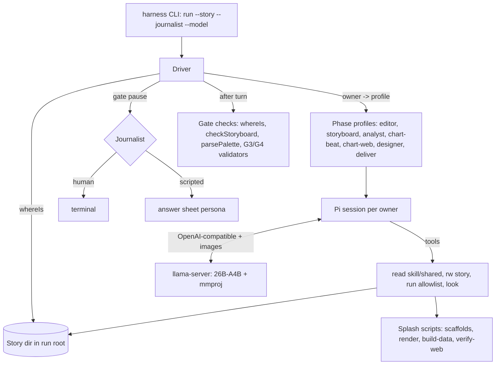
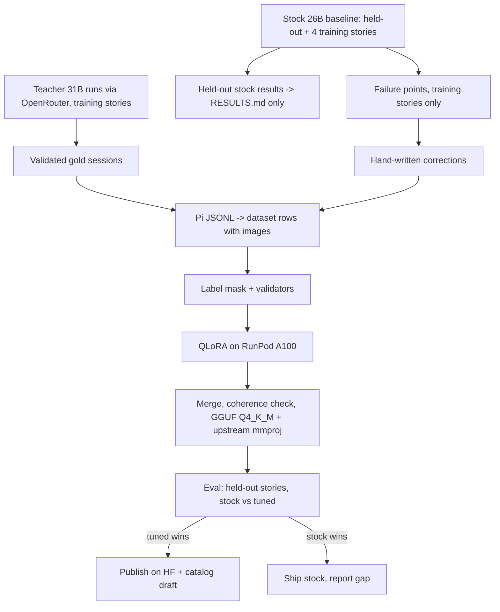

# Splash Local Harness on Pi - Plan

## Goal Capsule

- **Objective:** A journalist with a Mac (32 GB measured target, 48 GB comfortable) can take a real story from intake to a delivered static chart (PNG) and web chart (HTML) with Splash running entirely on local open models, with no paid API on the run path. It is packaged so Buried Signals' Investigator Harness can route a visual-production request to it.
- **Means:** A deterministic phase driver on the bare Pi SDK, with one Pi session per pipeline owner (KTD1, KTD2). The model is a stock Gemma 4 26B-A4B served by llama.cpp, plus a LoRA tuned with the Spotlight procedure and published on Hugging Face (KTD7–KTD10).
- **Product authority:** Rémy (Splash owner) decides product scope. Tom Vaillant (Buried Signals) owns the router, Engine and the Mycroft catalog, so anything touching those is a proposal to Tom, never a change we make.
- **Target date:** around 2026-10-30, Tom's Investigator Harness release (date unconfirmed).
- **Stop conditions:** stop and ask Rémy before any paid launch. That covers every OpenRouter batch, every RunPod pod and every public Hugging Face upload (R23). Stop and report if U1 shows the image path or memory fit fails, because KTD3 and the model choice rest on both.
- **Execution profile:** Bun + TypeScript for the harness, evaluation and serving scripts. Python (uv) only for training on the pod. Code, comments and commits are in English, with no mention of Claude or Anthropic.
- **Who finishes:** `ce-work` executes U1–U14 in this worktree (`feat-pi-harness`). Rémy approves spend and sends the message to Tom.

---

## Product Contract

Product Contract preservation: changed. R6 and F1 now name the real pipeline (framing, analysis and designer review were missing; palette sits inside storyboard), by Rémy's choice of the full pipeline over code-written personas. R15 now names OpenRouter as the teacher's host, by Rémy's choice. Restructured with no scope change: R10 now matches KTD5 (no description-listing step), R13 now says one resident slot, and F1 step 3 now hands Gate 1 to the storyboard owner. Assumptions were corrected to measured story counts. Every other ID is unchanged.

### Summary

A Splash harness on the bare Pi SDK drives one story through the full Splash pipeline and ends with a delivered static chart and web chart, running Gemma 4 26B-A4B locally: intake, framing, storyboard with palette, analysis, static craft, web craft, designer review, journalist approval, delivery. A Splash LoRA trained on teacher-generated gold trajectories ships on Hugging Face as GGUF plus mmproj. It replaces the stock model only when it beats it on held-out stories.

### Problem Frame

Tom is consolidating Buried Signals' agents into one local "Investigator Harness": a tuned decision model routes each request to a product harness and its tuned model, downloaded by Indicator Lab journalists. Spotlight already has its harness (Flue on Pi) and a tuned Gemma 4 12B. Splash today runs only inside frontier-model hosts (Claude Code, Goose), and its catalog entry (0.1.3) is Goose-only with no model.

Splash is harder to localise than Spotlight. Its craft step writes a bespoke React component per beat and then judges its own rendered PNG. That needs code generation and vision, not only procedure. Spotlight's own record shows the 12B could not reliably edit large HTML, and its published GGUF is text-only. Splash's skills are also large: the static-path SKILL.md files alone are about 33K tokens, and `skills/chart-web/SKILL.md` is 62 KB.

### Key Decisions

- **Bare Pi SDK, not Flue on Pi.** Sub-agents and durable sessions are ours to build. Governs R1, R3, R4. (session-settled: user-directed — chosen over Flue on Pi as Spotlight uses it: Tom's stated direction is Pi itself.)
- **The model keeps writing the bespoke component; base is Gemma 4 26B-A4B.** This preserves the doctrine (compose, don't select). The larger MoE buys code margin (LiveCodeBench v6 77.1 vs 72.0 for the 12B) at 3.8B active parameters. Governs R8, R12, R14. (session-settled: user-directed — chosen over the 12B with a component, and over a JSON spec rendered by code: keep the doctrine and take the code margin.)
- **v1 covers static and web chart formats.** Governs R6, R7. (session-settled: user-directed — chosen over static only and over stopping at storyboard.)
- **The harness traverses the real Splash pipeline, personas included.** The editor, analyst and designer each run as their own sub-agent. Governs R2, R6. (session-settled: user-directed — chosen over a short path where code writes framing, analysis and review: evaluation must be on the production pipeline.)
- **Gold trajectories come from a Gemma 4 31B teacher driving the real harness, with a scripted journalist at every gate.** This is Spotlight's method. Governs R15, R16. (session-settled: user-approved — chosen over Rémy answering gates by hand and over a mixed approach.)
- **The teacher runs through OpenRouter.** Governs R15. (session-settled: user-directed — chosen over a RunPod pod and over Rémy's Mac: that is what Tom's 31B teacher actually used, and it sits off the run path.)
- **Fallback: the harness ships with stock 26B-A4B if the tune is not proven in time.** Governs R20. (session-settled: user-approved — chosen over shipping only harness and tuned model together.)
- **Code holds the pipeline, the model holds the craft.** A deterministic driver decides the phase from the story directory and opens one fresh Pi session per owner. The session is loaded with that owner's skill only. This applies Spotlight's lessons: never put the discipline in the prompt, use real sub-agents, and evaluate on the real pipeline. Governs R1–R5.
- **No RLM sidecar in v1.** Intake profiling is already deterministic (`skills/intake/scripts/profile.mjs`), so CSVs never enter the context raw. Long articles and conversation compaction are handled by the main model. Governs R9.
- **Canonical skills are loaded as they are; a condensed local-tier variant is a measured last resort.** A second copy of a skill would break the repository's CARRIED rule. Governs R10, R11.
- **The hardware floor is the 32 GB Mac measured in U1.** The 48 GB target is the comfortable tier. Either way it sits above the Mycroft catalog's 24 GB floor, so 24 GB journalists cannot run Splash locally in v1. Governs R13.

### Actors

- A1. Journalist: brings an article and data, and answers the gates: takeaway, hand, format, palette when asked, candidates, approval, delivery form.
- A2. Splash harness: deterministic phase driver plus per-owner Pi sessions (editor, storyboard, analyst, craft, designer, deliver).
- A3. Local model: Gemma 4 26B-A4B (stock or tuned) on llama.cpp, with vision.
- A4. Scripted journalist: a persona that answers gates from a per-story answer sheet during data generation and evaluation.
- A5. Teacher model: Gemma 4 31B via OpenRouter, used only to produce training trajectories.
- A6. Router / Investigator Harness (Tom): hands a visual-production request to Splash. Its contract is not defined yet.

### Requirements

**Harness**

- R1. The harness runs on the bare Pi SDK and recovers the current phase from the story directory alone, through the existing `whereIs`, so any run can be stopped and resumed.
- R2. Each pipeline owner runs in its own Pi session with only that owner's skill and tools in context, and a session cannot start another owner's work.
- R3. Sessions are durable and resumable by story id after a crash or an approval pause.
- R4. A human gate is the model ending its turn. The harness advances only when the gate's file exists and passes its existing validator.
- R5. Every file path the model sees is absolute, and every write stays inside the story directory. Records written into the story keep story-relative paths.
- R6. The pipeline covers every stage below, ending with a PNG and a self-contained HTML in the story's export:
  - intake;
  - framing (Gate 1);
  - storyboard, including palette and two slots: one static, then one web (Gate 2);
  - analysis;
  - static chart craft;
  - web chart craft;
  - designer review;
  - journalist approval (Gate 3);
  - delivery (Gate 4).
- R7. The web chart is verified by the existing Chrome-driven check before approval. Chrome is local and free.
- R8. At the craft step the model writes the bespoke component, renders it, and looks at the rendered image before claiming the beat is done.
- R9. No raw dataset enters the model's context. The model reads the intake profile and bounded excerpts.

**Context budget**

- R10. Skills load dynamically: a session receives only its owner's skill body when its phase starts, and references are read on demand.
- R11. Every phase's measured context floor fits the serving context with room for the work. The measurement is a test, and a phase that overflows is reported, not silently truncated.

**Model and serving**

- R12. The local model is Gemma 4 26B-A4B in GGUF with its mmproj, served by llama.cpp with image input enabled.
- R13. Serving fits a 32 GB Mac alongside the rendering toolchain and Chrome. It follows Spotlight's serving profile (q8_0 KV cache, bounded reasoning budget), adapted to this model; one resident slot, because the driver issues one request at a time.
- R14. Nothing on the run path calls a paid API or needs an API key.

**Training data and tuning**

- R15. Gold trajectories are full runs of the real harness on real stories. The teacher model runs through OpenRouter, with the scripted journalist at every gate. Only runs that pass the pipeline's validators are kept.
- R16. Targeted corrections are hand-written turns placed at observed failure points of the stock model, in the same format as gold turns.
- R17. Training data includes turns where the model looks at its own render, so the tune does not lose vision. Vision layers stay frozen.
- R18. Loss is masked to the model's own generated tokens; tool results and images are never supervised.
- R19. At least two stories are held out from training and used only for evaluation.

**Release**

- R20. The tuned model ships only if it beats stock 26B-A4B on the held-out stories. Otherwise the harness ships with the stock model and the tune follows.
- R21. The GGUF, mmproj, LoRA adapter and a model card are published on Rémy's Hugging Face account, pinned by commit with checksums.
- R22. A Mycroft catalog entry for the Splash harness and its model is drafted in the same shape as Spotlight's, as a proposal to Tom.
- R23. GPU and API spend stays within 50 EUR and is tracked per run. Every paid launch and every public upload is confirmed by Rémy first.

### Key Flows

- F1. Story run
  - **Trigger:** A journalist (or the router) starts Splash on a story with an article and a CSV.
  - **Actors:** A1, A2, A3
  - **Steps:**
    1. The driver reads the phase.
    2. Intake freezes and profiles silently.
    3. The editor session restitutes the article and proposes takeaways, read-only. The journalist's Gate 1 answer opens the storyboard session, which writes `STORYBOARD.md`.
    4. The storyboard session runs the exchange, including palette, and records a static slot then a web slot. It ends its turn at each Gate 2 question.
    5. The analyst writes each beat's data.
    6. The static craft session writes, renders and looks. The web craft session writes, renders and passes the Chrome check.
    7. The designer reviews read-only.
    8. The journalist approves at Gate 3.
    9. Deliver offers forms and materialises the one chosen at Gate 4.
  - **Outcome:** PNG and HTML in the story's export, with every gate closed into a file.
  - **Covered by:** R1–R9
- F2. Gold data generation
  - **Trigger:** Rémy approves an OpenRouter spend.
  - **Actors:** A2, A4, A5
  - **Steps:**
    1. The teacher drives F1 on each training story.
    2. The scripted journalist answers each gate by resuming the session.
    3. Validators filter out failed runs.
    4. Stock-model failures on the same stories give the points where corrections are written.
  - **Outcome:** A training set of gold trajectories and corrections, with held-out stories untouched.
  - **Covered by:** R15–R19, R23
- F3. Tune, evaluate, release
  - **Trigger:** The training set is complete.
  - **Actors:** A3, A4
  - **Steps:**
    1. Train the LoRA on a RunPod pod.
    2. Merge and export GGUF with the upstream mmproj.
    3. Run F1 with the scripted journalist on held-out stories, for stock and tuned.
    4. Compare.
  - **Outcome:** Either the tuned model is published and drafted into the catalog, or the stock model ships and the gap is reported.
  - **Covered by:** R17–R23

### Acceptance Examples

- AE1. **Covers R4.** Given the storyboard session ended its turn without writing a valid `STORYBOARD.md`, when the driver checks the gate, then it refuses to open the next owner and says why.
- AE2. **Covers R3, R1.** Given a run killed during the static beat, when the harness restarts on the same story, then it resumes at the static beat, not at intake.
- AE3. **Covers R11.** Given the web chart phase's skill plus tools exceed the serving context, when the budget test runs, then it fails naming the phase and its token count.
- AE4. **Covers R20.** Given the tuned model completes fewer held-out stories than stock, or completes them with more gate refusals, when release is decided, then the stock model ships.
- AE5. **Covers R8.** Given the model claims a beat is done, when the session is inspected, then it contains a turn where the rendered image was given to the model after the last code change.

### Success Criteria

- Stock or tuned, the harness completes F1 on at least one held-out real story end to end, with only scripted-journalist input and no manual technical intervention.
- If the tuned model ships, it completes strictly more held-out runs than stock, or the same number with fewer gate refusals.
- Tom can read the status message and confirm the open points in one reply.

### Scope Boundaries

**Deferred for later**

- Maps (MapTiler bake and live proxy), Datawrapper, video, scrolly and image beats.
- An RLM sidecar for long articles or conversation folding.
- A 24 GB tier (a smaller base or a 12B variant).
- Engine launch code for Splash (rmdms is read-only on `buriedsignals/engine`) and the router itself.

**Outside this work**

- Any change to the Flue-based Spotlight harness or to the Mycroft catalog itself. Catalog work is a drafted proposal only.
- The old Apertus/Flue experiment (`feat/splash-apertus-sovereign`, sibling `harness/flue`) is obsolete, and is neither reused nor used as a model.
- Any change to craft-skill contracts. The harness drives skills as they are; condensing a skill is only reached through KTD5's measured last resort.

**Considered and not built**

- A second QA layer beyond the existing validators: `whereIs`, `checkStoryboard`, `parsePalette`, `verify-web.mjs` and the G3/G4 validators already refuse invalid states.
- An OS-level sandbox for code executed by `run render`: see Risks. The journalist's machine already runs Splash beats with full permissions under every host today; revisit if the harness is ever exposed to untrusted input.

### Dependencies / Assumptions

- Pi `@earendil-works/pi-coding-agent` 1.3.0 (published 2026-10-15) supports a custom OpenAI-compatible provider with `input: ["text","image"]`. In that mode it moves tool-result images into a follow-up user message. Verified in source; end to end against llama-server is U1.
- The 26B-A4B in Q4_K_M (16.95 GB) plus the BF16 mmproj (1.19 GB) plus a q8_0 KV cache fits the 25,559 MiB Metal working set measured on Rémy's M2 Max 32 GB. The estimate is 19–20 GiB; it is measured in U1.
- The upstream `unsloth/gemma-4-26B-A4B-it-GGUF` mmproj works with a LoRA-merged GGUF, as Spotlight reused upstream projector files.
- Unsloth supports LoRA on Gemma 4 26B-A4B with frozen vision and image-bearing data (`FastVisionModel`, `UnslothVisionDataCollator`). Expert weights are not 4-bit quantized, and the official notebook uses about 47 GB at 2k context; whether 30–40k-token trajectories fit on an A100 80 GB is decided by a two-step test.
- OpenRouter serves Gemma 4 31B with image input and tool calls. Unverified; checked first in U10.
- `stories/` measured 2026-10-21: 30 stories (1 production, 16 storyboard, 12 framing, 1 intake). Articles run 221–4,365 bytes. No story has `PALETTE.md`. Runs start from each story's `source/` only. About 24 are chart-eligible once map, scrolly and photo stories are excluded. That leaves about 22 training candidates for about 14 kept gold runs, so the teacher's completion rate must be at least about 65% (measured in the U10 pilot).
- Only `r8-chart-static-german-road-deaths-by-mode` is named nowhere in `skills/`, `shared/` or `agents/` (grep, 2026-10-21). Every other chart story appears in skill text, `real-gwis-wildfire-counts` in four files.
- Budget estimate: USD 18–25 of the 50 EUR, including one retry. This is unverified.

### Outstanding Questions

**Resolve Before Planning**

- None.

**For Tom (proposals, not blockers)**

- Router contract: none exists in spotlight, mycroft, engine or fine-tuning. Proposal: the router hands `(product, entry point, catalog model id, story directory)` to a resumable harness whose gates are end of turn.
- Pi versus Flue: Spotlight is still Flue on Pi (`@flue/runtime` 1.0.0-beta.9). Proposal: Splash uses bare Pi; confirm Spotlight is moving the same way.
- mmproj in the catalog: `models[]` has no field for a vision projector. Proposal: a second artifact on the Splash model entry.
- Hugging Face namespace: Spotlight's models live under `tomvaillant/`. Proposal: publish under Rémy's account, transferable later.
- Hardware floor: Splash needs 32 GB where the catalog says 24 GB. Proposal: a per-product `min_memory` on the model entry.
- Engine code and catalog signing: proposal that Tom writes the Engine launcher from our CLI entry point and signs the release.
- Masking: on Gemma 4 the chat template places tool results inside the model turn, so `train_on_responses_only` supervises them. Spotlight's v5 likely trained on tool outputs; our trainer masks them (KTD9).

### Sources / Research

- Brief: https://spotlight.buriedsignals.com/going-sovereign/
- Research dossiers (cite Tom's private repos, so they are kept out of this public repo): Obsidian vault `01-Projets/Splash harness Pi — dossiers/` (`fine-tuning.md`, `spotlight-mycroft.md`, `pi-gemma.md`, `splash-grounding.md`, `repo-research.md`, `framework-docs.md`, `tuning-reuse.md`).
- `buriedsignals/fine-tuning`: `LEARNINGS.md`, `docs/procedural-training.md`, `docs/tuning-12b.md`, `docs/local-serving-efficiency.md`, `scripts/gemma4-12b/train.py`, `scripts/gemma4-26b/pod.py`, `scripts/sample_gold.py`, `scripts/build_dataset.py`. `buriedsignals/kit`: `skills/fine-tuning-publish/SKILL.md`.
- `buriedsignals/spotlight`: `harness/flue/` and `harness/composition.json`. `buriedsignals/mycroft`: `catalog/catalog.json`.
- Pi v1.3.0 (`earendil-works/pi`, commit `71023aec`): `docs/models.md`, `docs/session-format.md`, `docs/compaction.md`, `packages/ai/src/api/openai-completions.ts` (image transport), issue #10885 (llama.cpp overflow not detected).
- llama.cpp `tools/server/README.md`: `--mmproj`, `--reasoning-budget`, `--parallel`, `--no-cache-idle-slots`, `-ctk/-ctv q8_0`. Gemma 4 tool-call issue #29655.

---

## Planning Contract

### Key Technical Decisions

- KTD1. **The driver loops on `whereIs` and dispatches by owner, with two rules of its own:**
  - **Pause rule.** In a conversational owner (editor, storyboard, designer, deliver), any end of turn after which `whereIs` has not advanced is a journalist pause. The answer goes back into the same session. `openGate(parseStoryboard(text).meta)` (`skills/splash/scripts/gate-contract.mjs`) only labels the gate when it returns one; otherwise the label is the projected phase. The `resume` sentence is never parsed.
  - **Framing handoff.** `whereIs` names `persona:editor` until `STORYBOARD.md` exists, and the editor may not write it (`agents/editor.md` `disallowed_verbs`). So once the editor's turn has ended, the journalist's Gate 1 answer opens a `skill:storyboard` session seeded with the editor's proposals. The editor is not resumed.

  `invokeResolvedOwner` (`skills/splash/scripts/orchestration.mjs`) is the seam: the harness supplies the `{skill, persona}` adapter map. Governs R1, R2, R4.
- KTD2. **One Pi session per (story, owner, slot, attempt), persisted as Pi JSONL under the run root.**
  - **Storage.** Sessions live in `<run-root>/.splash-harness/sessions/<story>/<owner>/<slot>-<attempt>/`. A session is resolved by opening the newest file there through `SessionManager`. No separate index exists.
  - **Attempts.** The attempt number rises when `whereIs` routes back to an owner after a review decision or `FEEDBACK.md`.
  - **Lifecycle.** A gate pause resumes the same session. A session counts as finished once `whereIs` has moved past its (owner, slot). The designer reviews each beat in a fresh session.

  Governs R2, R3.
- KTD3. **Images reach the model through a `look` tool.** The tool reads a PNG under the story directory and returns it as an image content block. The model declares `input: ["text","image"]`, and image size is capped through `inputLimits.images.resize` (1280 px, 1 MiB). It covers static renders and the `verify-web.mjs` screenshots, which are written outside `renders/` so the Gate 3 render digest is not invalidated. Governs R8, R12.
- KTD4. **No `bash`; three tool families with paths resolved against base directories:**
  - read-only skill and shared reads;
  - read/write/edit inside the story directory;
  - a `run` tool. It accepts only an allowlist of Splash commands as argv arrays (scaffolds, `render-directions*.mjs`, `build-data.mjs`, `verify-web.mjs`, `materialise`, and the documented `bun -e` helpers replaced by named harness actions), with cwd fixed to the run root.

  A persona's `allowed_verbs` (`agents/editor.md`, `agents/designer.md`) narrow its tool list. The boundary covers tools only. `run render` executes component files the model wrote, and that code is unconfined (a residual risk under Risks). Governs R2, R5, R9.
- KTD5. **The skill body goes into the system prompt, and references are read through the read tool.** Pi's own skill listing needs the model to `read` the body. That is unreliable for a small model and costs a turn, so each profile injects its owner's SKILL.md body directly. A budget test measures every profile's floor against the slot context. Condensation is allowed only for a profile that fails the test, and only as a harness-side derived view checked against its canonical source. Governs R10, R11.
- KTD6. **Runs happen in a run root outside the repository.** The run root is created from `skills/splash/assets/root-template/` with the story's `source/` inputs copied in. Two repo tests pin the contents of `stories/`, scaffolds resolve `#shared/` from cwd, and session files must never reach the byte-scanning `no-key-in-the-repository` test. Governs R5, R6.
- KTD7. **Serving profile for 26B-A4B is one slot of 65,536 tokens:**
  - `--parallel 1`, KV cache `-ctk/-ctv q8_0`, flash attention on, `--reasoning-budget 400`, `--mmproj` with the upstream BF16 file;
  - one Pi provider in `models.json`, with the compat block copied from Pi's llama.cpp provider;
  - `contextWindow` set exactly to the slot size, to dodge Pi #10885;
  - compaction `reserveTokens` 8192, with `keepRecentTokens` set per profile in `profiles.ts`.

  The driver sends one request at a time and the scripted journalist runs elsewhere (KTD8), so a second slot would only cost KV memory. The framework-docs dossier puts 64k under the 25,559 MiB working set with about 5 GiB of headroom. U1 measures this and may lower the slot. Governs R12, R13.
- KTD13. **Gate 3 is written by the harness and Gate 4 by the deliver session.**
  - **Gate 3.** On the journalist's approval, the harness calls `writeOutputReview` with three things it did not invent: the journalist's decision verbatim, the QA receipt from its own check run, and the designer session's `return_contract` text as `angleEvidenceBrief`.
  - **Gate 4.** The deliver session calls `materialise` through the `run` allowlist with the form the journalist named, as `skills/deliver/SKILL.md` instructs.

  Governs R4, R6.
- KTD14. **`harness/pi` is a Bun workspace of the root package.** The root `bun install --frozen-lockfile` (CI and the release baseline) then installs Pi and typebox, and fast-lane harness tests resolve them. Governs R11.
- KTD8. **The scripted journalist answers from a per-story answer sheet, through one pinned model call constrained to that sheet.** The sheet covers takeaway, hand, medium and format per slot, palette, candidates, approval and delivery form. The persona receives the model's last turn plus the sheet. It must answer only from the sheet, or with "I don't know", which the exchange accepts. Every answer is logged.
  - **Pinned model.** It always runs on the same pinned model: OpenRouter Gemma 4 31B at temperature 0 with a fixed seed. That holds for data generation and for every evaluation arm, so stock and tuned face the same interlocutor.
  - **Refusal.** `run-eval.ts` refuses a matrix whose arms differ in journalist model or decoding.

  This is evaluation tooling, not the shipped run path, where the journalist is human (R14). Governs R15, R19, R20.
- KTD9. **Our own label mask.** It supervises only the model's generated text and tool-call tokens, and masks tool results and image tokens. A test decodes the supervised spans of a fixture conversation and asserts that no tool-result text appears. This replaces `train_on_responses_only`, which supervises tool results on Gemma 4 because the template places them inside the model turn. Governs R18.
- KTD10. **Training reuses Tom's scripts, adapted rather than rewritten.**
  - Pod launch starts from `scripts/gemma4-26b/pod.py`, with the 27B launcher's safeguards: balance check, secure cloud, auto-terminate only on success.
  - Train, merge, coherence check and GGUF export follow the 12B scripts.
  - The dataset loader is rewritten to read Pi JSONL sessions, keeping images as content parts.

  Unsloth `FastVisionModel` with frozen vision layers, QLoRA r16, alpha 16, 3 epochs, LR 2e-4, on an A100 80 GB. A two-step smoke run on the longest row plus one image decides the sequence cap. Rows are compaction segments (U11), so each already fits the 64k slot. If the A100 cannot train at that length with gradient checkpointing, rows over the cap are dropped and counted, never truncated, because a truncated row would lose the skill body it runs under. Governs R17, R18, R21.
- KTD11. **Evaluation is the production run, scored from the story directory.** For each held-out story and model, the evaluator runs F1 with the scripted journalist and records:
  - the final `whereIs` phase reached;
  - gate refusals;
  - tool errors;
  - turns;
  - wall-clock time;
  - whether every craft session contains a `look` after its last write (AE5).

  The release rule compares completions first, then gate refusals (R20, AE4). Ties ship stock. Model sampling is pinned per arm (Gemma's recommended parameters with a fixed seed) and recorded in `RESULTS.md`, so a rerun reproduces the decision. Governs R19, R20.
- KTD12. **Harness tests join the derived lanes.** `scripts/test-lanes.mjs` gains `harness` in its walked roots. Live tests that need llama-server or OpenRouter follow the existing `*.live.test.ts` convention, and the rest classify themselves as fast or heavy by what they import. Governs R11.

### High-Level Technical Design

Component topology. Code owns every arrow; the model only acts inside a session.



Driver loop per story, in pseudo-code. This is directional, not a specification.

```text
loop:
  state = whereIs(story)
  if state.phase == done: stop(success)
  if state.status == blocked: stop(blocked, state.resume)
  owner = state.owner
  if owner == persona:editor and editorTurnEnded(story): owner = skill:storyboard   # framing handoff (KTD1)
  session = sessions.openOrResume(story, owner, slotOf(state), attemptOf(story, owner))
  turn = session.run(pendingAnswer or profiles[owner].kickoff(state))
  pendingAnswer = none
  closeHarnessOwnedSteps(story)          # palette/typeface/DIRECTION after G2, BRIEF binding, QA receipt, G3 on approval
  if whereIs(story) unchanged and profiles[owner].conversational:                  # pause rule (KTD1)
     pendingAnswer = journalist.answer(turn.lastText, gateLabel(story, state))
     if journalistRounds(story, owner) > CAP: stop(stalled, owner)
     continue                                        # same session resumes
  if whereIs(story) unchanged after N turns: stop(stalled, owner)
```

Data pipeline from runs to release.



### Output Structure

```text
harness/pi/
  README.md                      run, serve, evaluate
  src/cli.ts                     entry point (router-callable)
  src/driver.ts
  src/sessions.ts
  src/profiles.ts
  src/gates.ts                   harness-owned closures
  src/run-root.ts
  src/tools/{fs.ts,run.ts,look.ts}
  src/journalist/{human.ts,scripted.ts}
  src/budget.ts
  package.json                   workspace member (KTD14)
  serve/{llama-server.sh,fetch-model.ts,models.json,models.teacher.json}
  eval/{run-eval.ts,score.ts,teacher.ts,RESULTS.md,sheets/<story>.json}
  test/                          bun:test, fast/heavy/live by lane rules
training/                        Python (uv), runs on the pod
  pyproject.toml
  dataset/{build_from_pi.py,mask.py,validate.py}
  pod/{pod.py,setup.sh}
  train/{train.py,merge.py,export_gguf.sh}
  publish/{model_card.md.tmpl,publish.py}
  tests/
catalog/drafts/splash-local.json
```

### Assumptions

- The documented `bun -e` helpers in skills (for example `composeRunDirection`) can be exposed as named `run` actions without changing the skills. The harness preamble maps every `bun …` command an injected SKILL.md names to its `run` action.
- Teacher reasoning: whether OpenRouter returns Gemma 4 31B's thought content is recorded by the U1 probe. If it does, rows keep it in the thought channel and the mask supervises it. If not, rows carry no thoughts, and the student is evaluated as served (reasoning budget 400). Both arms record which applied.

### Risks

| Risk | Mitigation |
|---|---|
| Model-written component code executed by `run render` is unconfined, so R5's write boundary holds for tools only | Stated as-is in the README and the catalog proposal. The harness never claims confinement. |
| `chart-web` (62,685-byte SKILL.md) overflows its budget | U2 measures it first; the conditional condensation slot in Sequencing holds the fix, with Rémy's review before U6 |
| OpenRouter's 31B lacks image input or tool calls | Probed in U1 with one approved request, before any harness work depends on it |
| Teacher completion rate too low for about 14 kept runs | U10 pilot on 3 stories reports rate and cost per kept run before the batch |
| Week too short for the tuning track | Stock fallback (U14 depends on U9). Checkpoint: if U9 has not reached `done` on a held-out story by end of 2026-10-25, drop U10–U13 for v1 and tell Rémy |
| Image tokens from repeated `look` calls exhaust a craft session | Images capped at 1280 px; U2 charges two images per craft profile against its margin |

### Sequencing

U1 is the go/no-go spike. U2 and U3 run alongside it. U4 and every later harness unit proceed only after U1 passes. The stock baseline (U9) comes before any spend on data (U10). U14 (stock packaging) depends only on U9, so the fallback ships whatever happens to U10–U13.

| Day (approx.) | Units |
|---|---|
| 2026-10-22 | U1 (incl. OpenRouter probe), U2, U3 |
| 2026-10-22, conditional | Condense an overflowing profile per KTD5 (Rémy reviews before U6) |
| 2026-10-23 | U4, U5, U6 |
| 2026-10-24 | U7, U8, U9 (stock baseline) |
| 2026-10-25 | U14 (stock packaging), U10 pilot, checkpoint |
| 2026-10-26 | U10 batch, U11 |
| 2026-10-27 | U12 (tune) |
| 2026-10-28/29 | U13, U14 update if the tune ships |

---

## Implementation Units

| U-ID | Title | Key files | Depends on |
|---|---|---|---|
| U1 | Serving and image-path spike | `harness/pi/serve/*`, `harness/pi/test/serve.live.test.ts` | none |
| U2 | Context budget per profile | `harness/pi/src/budget.ts`, `harness/pi/test/budget.test.ts` | none |
| U3 | Run root and story staging | `harness/pi/src/run-root.ts`, `scripts/test-lanes.mjs`, `.gitignore` | none |
| U4 | Pi session layer | `harness/pi/src/sessions.ts` | U1, U3 |
| U5 | Tools: fs, run, look | `harness/pi/src/tools/*` | U3 |
| U6 | Profiles and driver loop | `harness/pi/src/profiles.ts`, `driver.ts`, `cli.ts` | U2, U4, U5 |
| U7 | Harness-owned gate closures | `harness/pi/src/gates.ts` | U6 |
| U8 | Journalist: human and scripted | `harness/pi/src/journalist/*`, `eval/sheets/*` | U6 |
| U9 | Evaluator and stock baseline | `harness/pi/eval/*` | U7, U8 |
| U10 | Gold generation and corrections | `harness/pi/eval/teacher.ts`, `training/data/` (gitignored) | U9 |
| U11 | Dataset builder and label mask | `training/dataset/*` | U10 |
| U12 | Pod, train, merge, export | `training/pod/*`, `training/train/*` | U11 |
| U13 | Tuned evaluation, release and publish | `training/publish/*`, `harness/pi/eval/*` | U9 (U12 if it produced artifacts) |
| U14 | Catalog draft, README, message to Tom | `catalog/drafts/splash-local.json`, `harness/pi/README.md` | U9 (updated after U13) |

### U1. Serving and image-path spike

**Goal:** Prove three things before any harness work depends on them:
- 26B-A4B plus mmproj runs on the 32 GB Mac in one 64k slot;
- a PNG returned by a Pi tool reaches the model and is described correctly;
- the OpenRouter Gemma 4 31B teacher accepts an image and a tool call.

**Requirements:** R12, R13, R14, R15; KTD3, KTD7, KTD8.

**Dependencies:** None.

**Files:**
- Create `harness/pi/serve/llama-server.sh` (pinned llama.cpp build, flags per KTD7, model and mmproj paths from env).
- Create `harness/pi/serve/models.json`.
- Create `harness/pi/serve/fetch-model.ts` (downloads the GGUF and mmproj from `unsloth/gemma-4-26B-A4B-it-GGUF` at a pinned commit, verifies sha256).
- Create `harness/pi/test/serve.live.test.ts`.
- Create `harness/pi/test/teacher-probe.live.test.ts`.
- Create `harness/pi/serve/models.teacher.json` (OpenRouter provider; `contextWindow` and compaction identical to the local entry).
- Create `harness/pi/package.json` (pins `@earendil-works/pi-coding-agent` 1.3.0 and `typebox`).
- Modify `package.json` (root: add `harness/pi` to `workspaces`, KTD14) and `bun.lock`.
- Create `harness/pi/README.md` (measurements section).

**Approach:**
1. Install llama.cpp via Homebrew or a pinned release build.
2. Start the server.
3. Measure resident memory with a 60k-token prompt while Chrome runs `verify-web.mjs`, and record tokens/s for prompt and generation.
4. Run a Pi session with a single custom tool that returns a known proof render (`proof/static-bar-top-emitters-2024/renders/creme.png`), and ask for the title text and bar count.
5. If memory fails, lower the slot size before any other change, and record the measured number in the README.
6. With Rémy's approval of that single request, send one OpenRouter request to the 31B with an image and a tool. Record:
   - whether both are honoured;
   - whether reasoning content is returned;
   - the cost.

**Execution note:** Smoke-first. This unit decides whether the rest proceeds. Report the measurements and the probe result before starting U4; a failed probe stops F2 planning, not the harness.

**Patterns to follow:** Spotlight's serving flags (`docs/local-serving-efficiency.md` in `buriedsignals/fine-tuning`); the Pi `models.json` example in the framework-docs dossier.

**Test scenarios:**
- Happy path: a session given the proof PNG through the tool answers with the chart's actual title text.
- Happy path: a 60k-token request completes within the slot while Chrome runs.
- Error path: a request that overflows the slot is reported as an error by the harness wrapper, not silently retried, which guards against Pi #10885.
- Edge case: a tool returns a 2400 px PNG and the request still fits (resize to 1280 px applied).
- Happy path: the teacher probe returns a tool call and a description of the image.
- Integration: the local and teacher model entries share `contextWindow` and compaction values.

**Verification:** The README records:
- measured peak memory;
- tokens/s;
- the model's description of the proof image;
- the teacher probe result.

The live tests pass.

### U2. Context budget per profile

**Goal:** Measure each owner profile's context floor (system prompt plus skill body plus tool schemas) and fail when it leaves less than a fixed working margin in the slot.

**Requirements:** R10, R11; KTD5; AE3.

**Dependencies:** None (reads skills only). U6 later registers profiles here.

**Files:**
- Create `harness/pi/src/budget.ts`.
- Create `harness/pi/test/budget.test.ts` (fast lane: a conservative bytes-per-token estimate).
- Create `harness/pi/test/budget.live.test.ts` (exact counts through llama-server's `/tokenize`).

**Approach:** The floor has four parts:
- the injected SKILL.md body;
- the shared doctrine excerpt each profile needs;
- the tool definitions;
- the harness preamble.

Each profile must satisfy two inequalities against the KTD7 slot:
- floor + 20k working tokens (craft) or 12k (others) + two 1280 px images (craft) ≤ `contextWindow` − `reserveTokens`;
- floor + the profile's `keepRecentTokens` + 2k summary allowance < `contextWindow` − `reserveTokens`, so compaction can actually bring a session back under its trigger.

A failing profile is named with its count. Condensing it then follows KTD5 in the conditional Sequencing slot, and is never part of this unit.

**Patterns to follow:** The walk-and-assert style of `skills/splash/test/carried-copies.test.ts`; derived-from-filesystem counts like `scripts/test-lanes.mjs --check`.

**Test scenarios:**
- Happy path: the editor profile reports a floor below both limits.
- Covers AE3. When `chart-web`'s floor exceeds its limit, the test fails naming `chart-web` and the count.
- Error path: a profile whose floor plus `keepRecentTokens` reaches the compaction trigger fails, naming the profile and the compaction inequality.
- Edge case: a profile whose skill file is missing fails with the missing path, not a zero count.

**Verification:** The fast and live budget tests pass, or produce a named list of overflowing profiles that is reported to Rémy before U6.

### U3. Run root and story staging

**Goal:** Create an isolated Splash run root outside the repository and stage a story into it from its `source/` inputs only.

**Requirements:** R5, R6; KTD6, KTD12.

**Dependencies:** None.

**Files:**
- Create `harness/pi/src/run-root.ts`.
- Create `harness/pi/test/run-root.test.ts`.
- Modify `scripts/test-lanes.mjs` (add `harness` to the walked roots).
- Modify `.gitignore` (`training/data/`, `*.gguf`, `.splash-harness/`).

**Approach:**
1. Build the root from `skills/splash/assets/root-template/`:
   - copy its `package.json` (with `#shared/*`);
   - copy `shared/` byte for byte;
   - symlink `skills/` and `proof/` from the checkout, never copied, since scaffolds copy worked examples from `proof/`;
   - write a NEWSROOM.md from the example.
2. Run `bun install` in the run root so `checkDependencies` passes.
3. Stage a story with `createStory`.
4. Copy the repo story's original article and CSV into it, and run `freezeSource` through the harness, not the model, since intake asks nothing.
5. Default run root: `~/.splash-harness/runs/<run-id>/`.

**Patterns to follow:** `skills/splash/scripts/new-story.mjs` (`createStory`), `skills/intake/scripts/freeze.mjs` (`freezeSource`), and fixture creation in `skills/splash/test/where.test.ts`.

**Test scenarios:**
- Happy path: staging `stress-z-budget-parts` yields a story whose `whereIs` phase is `framing`.
- Edge case: staging a story with no `data.csv` (`stress-h-site-photographs`) is refused naming the missing file.
- Integration: after staging, `bun run test:lanes` lists the new harness tests in exactly one lane.
- Integration: a staged run root passes `checkDependencies`.
- Error path: a run root inside the repository checkout is refused.

**Verification:** A staged story resolves through `whereIs` from the run root. The repo `stories/` is untouched (`git status` clean). `bun run test` passes from a clean `bun install --frozen-lockfile`.

### U4. Pi session layer

**Goal:** Create, persist, resume and close one Pi session per (story, owner, slot, attempt), and report one turn's outcome to the driver.

**Requirements:** R2, R3; KTD2, KTD7; AE2.

**Dependencies:** U1, U3.

**Files:**
- Create `harness/pi/src/sessions.ts`.
- Create `harness/pi/test/sessions.test.ts`.
- Create `harness/pi/test/sessions.live.test.ts`.

**Approach:** Use `createAgentSession` with an injected `ModelRuntime` (models.json from U1), a file `SessionManager` at the KTD2 path, in-memory settings (compaction per KTD7, no extensions, no Pi skill discovery), and a profile's system prompt and tools. A turn is done at `agent_settled`. The outcome returned is last assistant text, tool errors, token usage and an overflow flag. Session resolution follows KTD2 (newest file in the key's directory), with no separate index.

**Patterns to follow:** The SDK snippet in the framework-docs dossier (`createAgentSession`, `SessionManager.open(SessionManager.findById(...))`).

**Test scenarios:**
- Happy path: a new owner session is created under its (story, owner, slot, attempt) directory.
- Covers AE2. When the process is killed after a tool call and restarted, the same session is reopened and its history contains the earlier tool call.
- Edge case: the designer reviewing slot 2 after slot 1 opens a fresh session, not slot 1's.
- Edge case: a routed-back revision of the static beat opens attempt 2, keeping attempt 1 on disk.
- Error path: the model server is unreachable, so the turn fails with a clear error and the session file is not corrupted.

**Verification:** The live test resumes a real session across processes.

### U5. Tools: fs, run, look

**Goal:** Give sessions exactly the capabilities the skills need, with paths resolved against allowed base directories.

**Requirements:** R5, R7, R8, R9; KTD3, KTD4.

**Dependencies:** U3.

**Files:**
- Create `harness/pi/src/tools/fs.ts`.
- Create `harness/pi/src/tools/run.ts`.
- Create `harness/pi/src/tools/look.ts`.
- Create `harness/pi/test/tools.test.ts`.
- Create `harness/pi/test/run-tool.test.ts` (heavy: spawns bun).

**Approach:**
- `fs` reads anywhere under the run root's `skills/`, `shared/` and `proof/`, and reads and writes under the story directory.
- `run` takes a named action plus flat string arguments, which avoids Gemma 4's multi-line tool-argument bug #29655. Each action maps to one allowlisted argv:
  - the `scaffold-static-beat.mjs` and `scaffold-web-beat.mjs` scaffolds;
  - `render-directions.mjs` and `render-directions-web.mjs`;
  - `build-data.mjs`;
  - `verify-web.mjs --file <story>/beats/<beat>/renders/<page>.html --shots --out <story>/.harness/shots/<beat>`, with `--file` required and under the story;
  - deliver's `materialise` (KTD13);
  - named helpers wrapping the documented `bun -e` snippets.

  It returns exit code and truncated stdout/stderr.
- `look` returns an image block for a PNG under the story directory (KTD3).
- Reading `data.csv` returns a bounded excerpt (R9).

**Patterns to follow:** The CLI usage blocks in `skills/chart-beat/SKILL.md` and `skills/chart-web/SKILL.md`.

**Test scenarios:**
- Happy path: `fs.write` to `beats/1/Chart.tsx` inside the story succeeds.
- Error path: `fs.write` to `../../outside.txt` is refused naming the base directory.
- Error path: `run` with an action outside the allowlist is refused.
- Happy path: `run render` on a scaffolded proof beat writes `renders/*.png` and returns exit 0.
- Happy path: `look` on that PNG returns one image block with mime `image/png`.
- Edge case: reading a 7,585-row CSV returns a truncated excerpt with a note pointing to `profile.json`.
- Integration: `verify-web` shots land outside `renders/`, and the beat's render digest is unchanged.
- Error path: `run verify-web` without a `--file` under the story directory is refused, so it can never pass on the seed page.
- Happy path: `run scaffold-static` with no `--from` succeeds in a staged story, and the model can read the named worked example under `proof/`.

**Verification:** Every tool has a passing test, and no tool writes outside the story directory. Code executed by `run` is model-authored and unconfined (Risks).

### U6. Profiles and driver loop

**Goal:** Map each `whereIs` owner to a phase profile and run the loop that advances a story until it is done, blocked, awaiting the journalist, or stalled.

**Requirements:** R1, R2, R4, R6, R10; KTD1, KTD5; AE1; F1.

**Dependencies:** U2, U4, U5.

**Files:**
- Create `harness/pi/src/profiles.ts`.
- Create `harness/pi/src/driver.ts`.
- Create `harness/pi/src/cli.ts`.
- Create `harness/pi/test/driver.test.ts` (scripted fake model).
- Create `harness/pi/test/profiles.test.ts`.

**Approach:**
- Profiles: `persona:editor`, `skill:storyboard` (includes palette per `skills/storyboard/references/exchange.md`), `skill:analyst`, `skill:chart-beat`, `skill:chart-web`, `persona:designer`, `skill:deliver`.
- Each profile names its skill body, its tools (narrowed by persona `allowed_verbs`), and a kickoff message built from the `whereIs` result.
- Each profile also sets its `keepRecentTokens` (KTD7) and whether it is conversational (KTD1 pause rule).
- The driver loop follows the HTD pseudo-code, including the framing handoff and the pause rule.
- `cli.ts run --story <path> --journalist human|scripted:<sheet> --model <id>` is the entry point a router calls. It prints the final `whereIs` result as JSON.
- A stall (no phase change after a bounded number of turns or journalist rounds per owner) stops with the last `resume` text.

**Execution note:** Drive the loop test-first against a fake model that replays canned turns, so gate logic is proven without llama-server.

**Patterns to follow:** `skills/splash/scripts/orchestration.mjs` (`invokeResolvedOwner`), the owner table in `skills/splash/SKILL.md`, `agents/editor.md`, `agents/designer.md`.

**Test scenarios:**
- Happy path: on a staged story at `framing`, the driver opens the editor profile.
- Happy path: after the editor's turn and one scripted Gate 1 answer, the driver opens the storyboard profile (not the editor), and the story reaches `storyboard` with a `STORYBOARD.md` written by it.
- Happy path: a storyboard turn that ends with a hand question and no `whereIs` change is routed to the journalist, and the answer resumes the same session.
- Covers AE1. When the storyboard turn ends without a valid `STORYBOARD.md`, the driver does not open the analyst and reports the `checkStoryboard` gap.
- Happy path: after `STORYBOARD.md` gains a valid static slot, the driver resolves to the analyst.
- Edge case: a `blocked` status (an exhausted reservation) stops the run with the resolver's resume text.
- Error path: a stalled owner stops after the turn cap with a stall report naming the owner.
- Integration: the designer profile exposes no write tool.

**Verification:** With a fake model, the driver walks a fixture story through every owner transition. The CLI prints valid JSON.

### U7. Harness-owned gate closures

**Goal:** Close the pipeline steps that no skill writes, so a correct model run can reach `done`.

**Requirements:** R4, R6, R7; KTD1.

**Dependencies:** U6.

**Files:**
- Create `harness/pi/src/gates.ts`.
- Create `harness/pi/test/gates.test.ts`.

**Approach:**
1. After Gate 2: verify `PALETTE.md` with `readPalette` and `parsePalette` and `TYPEFACE.md`, then write `DIRECTION.md` via `composeRunDirection` and `writeRunDirection` if missing.
2. Before review: bind `BRIEF.md` front matter (`planVersion`, `findingIds`) from the storyboard.
3. Record a QA receipt from the actual check run: a static render exiting 0 with PNG present, or `verify-web.mjs` exiting 0.
4. At Gate 3, write `OUTPUT-REVIEW.json` per KTD13.
5. At Gate 4, verify only. The deliver session materialises (KTD13), and the harness confirms with `whereIs` that the G4 files validate.

None of these closures invents a pass. A failed check leaves the gate open.

**Patterns to follow:** `apps/goose/compatibility/runtime-closure.mjs` (`renderDigest`, `writeOutputReview`, `materialise`), `skills/deliver/test/output-review-fixture.ts` (`approveCurrentOutput`), `shared/design-base/run-direction.mjs`.

**Test scenarios:**
- Happy path: after a valid G2, `DIRECTION.md` is written and the chart-beat scaffold accepts the story.
- Error path: a `PALETTE.md` with an accent under 3:1 keeps the story at storyboard with `parsePalette`'s message.
- Error path: `verify-web.mjs` exiting 1 produces no QA receipt, and approval is refused.
- Happy path: the journalist approves, `OUTPUT-REVIEW.json` validates in `whereIs`, and the phase moves to delivery.
- Error path: a designer session with no `return_contract` text leaves Gate 3 unwritten and says why.
- Happy path: the journalist picks `owned-file`, the deliver session runs `materialise`, and `export/<id>/` holds the PNG plus `HANDOVER.md`.

**Verification:** A fixture story with pre-written beats reaches `done` through the harness closures alone.

### U8. Journalist: human and scripted

**Goal:** Answer gate pauses either from a terminal or from a per-story answer sheet.

**Requirements:** R4, R15, R19; KTD8; A1, A4.

**Dependencies:** U6.

**Files:**
- Create `harness/pi/src/journalist/human.ts`.
- Create `harness/pi/src/journalist/scripted.ts`.
- Create `harness/pi/eval/sheets/<story>.json` for every chart story used.
- Create `harness/pi/test/journalist.test.ts`.

**Approach:** Sheet fields mirror the questions in `skills/storyboard/references/exchange.md` (restitution correction, takeaway, the hand, slots with medium, format and size, palette choice, candidates) and in deliver (form, handover fields). Every chart story's sheet records a static slot then a web slot. The scripted persona sends the model's last turn and the sheet to its configured model, with a system prompt that allows only sheet facts or "I don't know". Answers and the gate id are logged next to the session.

**Patterns to follow:** The hand-written answers in `stories/heat-pump-adoption-across-europe/STORYBOARD.md` and the fixture in `skills/splash/test/where.test.ts`.

**Test scenarios:**
- Happy path: at G1 the scripted persona returns the sheet's takeaway verbatim.
- Edge case: a question not covered by the sheet gets "I don't know", and the exchange continues.
- Error path: a sheet missing a required field fails validation before the run starts.
- Happy path: the human journalist's terminal answer resumes the paused owner session.

**Verification:** Sheets exist and validate for every training and held-out chart story. The two held-out stories are:
- `r8-chart-static-german-road-deaths-by-mode`, the only chart story named nowhere in skill text, and the one the Success Criteria proof uses;
- `real-gwis-wildfire-counts`, the large-panel case for R9, which skill text names in four files.

### U9. Evaluator and stock baseline

**Goal:** Run F1 end to end with the scripted journalist and score each run. Then record the stock 26B-A4B baseline on the two held-out stories plus 4 training stories. Add more training stories only if fewer than about 12 distinct failure points result.

**Requirements:** R19, R20; KTD11; AE4, AE5.

**Dependencies:** U7, U8.

**Files:**
- Create `harness/pi/eval/run-eval.ts`.
- Create `harness/pi/eval/score.ts`.
- Create `harness/pi/test/score.test.ts`.
- Create `harness/pi/eval/results/` (gitignored raw output; a committed summary table).

**Approach:** The scorer reads the story directory and session files only. Metrics are per KTD11. Failure points (owner, turn, error) from training stories become the correction targets for U10. Held-out stock results go to `RESULTS.md` only, and never become corrections (R19). Journalist and sampling pins are per KTD8 and KTD11.

**Patterns to follow:** Spotlight's "invariant-9" pass criterion (fine-tuning dossier §4) as the model for a binary end-to-end check.

**Test scenarios:**
- Happy path: a fixture story at `done` scores as completed.
- Covers AE5. A craft session whose last `look` precedes its last write is flagged.
- Covers AE4. Given tuned 1 completion and stock 2, the release rule picks stock.
- Edge case: a stalled run scores as not completed and records its stall owner.
- Error path: an evaluation matrix whose arms use different journalist models or decoding is refused before any run.

**Verification:** A baseline summary exists with per-story phase reached. At least one held-out story's stock result is known before U10 starts.

### U10. Gold generation and corrections

**Goal:** Produce about 14 validated gold trajectories from the 31B teacher, and about 12 corrections at the stock model's failure points.

**Requirements:** R15, R16, R17, R19, R23; F2.

**Dependencies:** U9.

**Files:**
- Create `harness/pi/eval/teacher.ts` (selects `serve/models.teacher.json` from U1, key from the environment; per-run and per-batch cost ceilings).
- Create `harness/pi/test/teacher.test.ts`.
- Create `training/data/` (gitignored: sessions, manifests).
- Create `training/data/manifest.schema.json` (committed).

**Approach:**
1. Pilot: with Rémy's approval, run the teacher on 3 training stories. Report completion rate and cost per kept run.
2. Batch: launch only after Rémy approves it on that measured rate. The cost ceilings come from the approved estimate. Reaching a run's ceiling aborts that run, and reaching the batch ceiling stops the batch. The manifest records the cost reached.
3. Teacher runs use the same CLI with `--model teacher`, under the same context window and compaction as the student (U1), so trajectories are produced by the production harness. A run is kept only if it reaches `done`.
4. Corrections are written as the stock model's real context up to its failure, followed by a hand-written correct turn, stored in the same session format. Only failures on training stories qualify.
5. Held-out stories never enter the data.

**Execution note:** Spend-gated. Nothing runs against OpenRouter until Rémy approves the estimate.

**Patterns to follow:** Tom's `scripts/sample_gold.py` (resume-the-session-as-human loop) and LEARNINGS rules: never strip approval gates, never train on empty assistant turns.

**Test scenarios:**
- Happy path: a teacher run on a training story that reaches `done` is added to the manifest.
- Error path: a teacher run that stalls is excluded, and the manifest records why.
- Error path: a held-out story id in the training manifest fails validation.
- Error path: a correction whose source failure is on a held-out story fails validation.
- Error path: a run that reaches its cost ceiling is aborted, recorded with its cost, and the batch stops at the batch ceiling.

**Verification:** The manifest lists the kept runs and corrections, the spend per run, and no held-out story.

### U11. Dataset builder and label mask

**Goal:** Convert kept Pi sessions and corrections into training rows with images, and prove the mask supervises only generated tokens.

**Requirements:** R17, R18; KTD9, KTD10.

**Dependencies:** U10.

**Files:**
- Create `training/dataset/build_from_pi.py`.
- Create `training/dataset/mask.py`.
- Create `training/dataset/validate.py`.
- Create `training/tests/test_mask.py`.
- Create `training/tests/test_build.py`.
- Create `training/pyproject.toml`.

**Approach:** Each row is `{meta, tools, messages}` with OpenAI-style tool calls, `role: tool` results and image parts, in the format Tom's trainer reads.
- **Compaction.** A session yields one row per compaction segment: the system prompt, the compaction summary, the kept messages, then the turns up to the next compaction. Every row therefore holds exactly the context the model saw.
- **Paths.** Paths inside rows are rewritten to a neutral run root, because Tom's v5 data kept 1,423 machine-specific paths.
- **Reasoning.** Thought content follows the U1 probe result (Assumptions). The mask is applied on the tokenized Gemma 4 template and covers model text and tool calls only. Validators refuse:
- empty assistant turns;
- rows over the sequence cap;
- images that never reach the model;
- held-out story ids.

**Execution note:** Write the mask test first against a fixture conversation with a tool result and an image.

**Patterns to follow:** Tom's `scripts/build_dataset.py` row shape; the Gemma 4 `chat_template.jinja` tool-result placement noted in the tuning dossier.

**Test scenarios:**
- Happy path: a fixture session with one `look` produces a row with one image part placed before its text.
- Happy path: decoding the supervised token spans yields only model-authored text and tool calls.
- Error path: the decoded supervised spans include any tool-result string, so the test fails.
- Edge case: a row with an empty assistant turn is rejected with its index.
- Edge case: a machine-specific absolute path is rewritten.
- Edge case: a fixture session with one compaction entry yields two rows, and no pre-compaction message appears in the second.

**Verification:** `training/tests` pass locally on CPU. The dataset summary lists rows, token lengths and image counts.

### U12. Pod, train, merge, export

**Goal:** Train the LoRA on a RunPod A100 80 GB within budget, then produce a merged, coherent GGUF Q4_K_M with the upstream mmproj.

**Requirements:** R17, R18, R21, R23; KTD10.

**Dependencies:** U11.

**Files:**
- Create `training/pod/pod.py`.
- Create `training/pod/setup.sh`.
- Create `training/train/train.py`.
- Create `training/train/merge.py`.
- Create `training/train/export_gguf.sh`.
- Create `training/tests/test_pod_guard.py`.

**Approach:**
1. `pod.py` refuses to launch without an explicit budget argument and a positive balance, prints the hourly price, and auto-terminates only after artifacts are copied off.
2. Run the two-step smoke run (longest row plus one image) before the full run; every code path of the full run is exercised in the smoke run.
3. Merge with Unsloth, then run a coherence check (a short generation), then convert to f16, then quantize to Q4_K_M.
4. Write heavy files under `/root`, never `/workspace`.
5. Pin unsloth, transformers, trl and torch versions in `pyproject.toml` from the run that succeeds.

**Execution note:** Spend-gated. Show Rémy the price and expected duration before `pod.py` launches.

**Patterns to follow:** `buriedsignals/fine-tuning` `scripts/gemma4-26b/pod.py`, the 27B launcher's guards, `scripts/gemma4-12b/{train,merge}.py`, `gguf.py` (upstream mmproj reuse).

**Test scenarios:**
- Error path: `pod.py` without a budget argument exits before calling the RunPod API.
- Error path: a balance below the estimate exits with the two numbers.
- Happy path (on pod): the smoke run completes two steps and writes an adapter.
- Happy path (on pod): the merged model's coherence check produces non-empty text containing no template tokens.

**Verification:** The LoRA adapter, merged GGUF Q4_K_M and mmproj are copied off the pod with sha256 values, and the run's cost is logged.

### U13. Tuned evaluation, release and publish

**Goal:** Evaluate tuned against stock on the held-out stories, decide the release per R20, and publish on Hugging Face if the tune wins.

**Requirements:** R19, R20, R21, R23; KTD11; AE4; F3.

**Dependencies:** U9, and U12 when it produced artifacts. If U12 failed or was skipped at the checkpoint, U13 records "ship stock" in `RESULTS.md` and stops.

**Files:**
- Create `training/publish/model_card.md.tmpl`.
- Create `training/publish/publish.py`.
- Modify `harness/pi/eval/run-eval.ts` (model matrix).
- Create `harness/pi/eval/RESULTS.md` (committed summary).

**Approach:** Run each held-out story with both models at least twice. The model card follows the kit checklist headings, states Apache 2.0, the base model, data provenance (teacher, scripted journalist, story list), the masking rule and the evaluation table. `publish.py` uploads to Rémy's account only after confirmation, then records the HF commit and sha256 for U14.

**Execution note:** The public upload is confirmation-gated.

**Patterns to follow:** `buriedsignals/kit` `skills/fine-tuning-publish/SKILL.md` steps and Tom's model-card structure (tuning dossier §6).

**Test scenarios:**
- Covers AE4. A results table where stock completes more runs yields the decision "ship stock".
- Error path: `publish.py` with no recorded sha256 for an artifact refuses to upload.

**Verification:** `RESULTS.md` holds the comparison and the decision. If the tune wins, the HF repo is pinned by commit, with checksums matching local files.

### U14. Catalog draft, README, message to Tom

**Goal:** Hand Tom a ready-to-review integration package.

**Requirements:** R22; Outstanding Questions for Tom.

**Dependencies:** U9. It is updated after U13 if the tune ships.

**Files:**
- Create `catalog/drafts/splash-local.json` (product entry plus a `models[]` entry shaped like Spotlight's, pointing at the stock upstream GGUF and mmproj, the mmproj as a second artifact).
- Modify `harness/pi/README.md` (serve, run, evaluate, measured hardware numbers).
- Create the message to Tom in the vault, outside the repository.

**Approach:** Mirror the Spotlight entry in `buriedsignals/mycroft` `catalog/catalog.json` field by field. Leave signing and digests of the install contract to Tom. Draft for the stock model first. If U13 ships a tune, swap in the tuned repo, commit and sha256. The message is short: status, choices made, and only the proposals listed under Outstanding Questions, each as "found A, propose B, confirm?". It states the unconfined-code risk.

**Test scenarios:**
- Test expectation: none, because this is documentation and a draft JSON. A one-off parse check confirms the JSON is valid.

**Verification:** Rémy has read the message and the draft entry before anything is sent.

---

## Verification Contract

| Scope | Command | When |
|---|---|---|
| Fast lane incl. harness unit tests | `bun --no-env-file run test` | every unit |
| Heavy lane (render, spawn, Chrome) | `bun --no-env-file run test:heavy` | before each commit touching U3, U5, U7 |
| Lane derivation | `bun run test:lanes` | U3 and whenever a harness test is added |
| Live harness tests (llama-server, OpenRouter) | `bun test harness/pi --test-name-pattern live` via the `*.live.test.ts` convention (`bun run test:live`) | U1, U2, U4, U9 |
| Training unit tests | `uv run pytest training/tests` | U11, U12 |
| Release baseline | `bun install --frozen-lockfile`, `bun --no-env-file run test:all`, `matrix:check`, `survey:check`, `catalog:check` | before merge |
| End-to-end | `bun harness/pi/src/cli.ts run --story <staged held-out> --journalist scripted:<sheet>` reaches `done` | U9, U13 |

Live tests are skipped only when llama-server or the OpenRouter key is absent, and the skip is reported, never counted as a pass.

## Definition of Done

- Every unit's Verification holds, and the fast, heavy and training suites pass.
- The harness completes at least one held-out story end to end on the stock model (Success Criteria).
- `RESULTS.md` records the stock-vs-tuned comparison and the release decision under R20.
- If the tune ships, the Hugging Face artifacts are public, pinned and checksummed. Otherwise the reason is recorded.
- Spend per run is logged, and the total is at or under 50 EUR.
- The catalog draft, the README and the message to Tom exist, and Rémy has reviewed them.
- No GGUF, session file, OpenRouter key or Tom-private dossier is tracked in git.
- Abandoned spike code is removed from the diff.
