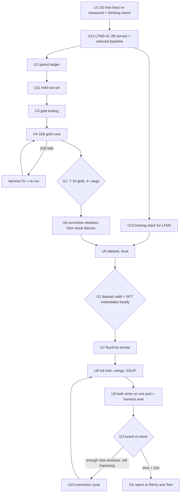

# Pi Harness Tuning Loop (Tom's Method) - Plan

> **Superseded on 2026-11-07** by `docs/plans/2026-11-07-1448-feat-pi-harness-tom-method-plan.md` (Tom's debrief of 2026-11-05). Kept as history.

## Goal Capsule

- **Objective:** a journalist running Splash locally gets a tuned small model that carries a story through the harness to a faithful delivery more often than the same model untuned, measured on held-out stories, so the local mode can ship for Tom's internal pilot.
- **Student model (changed 2026-10-28, KTD11):** `LiquidAI/LFM3-VL-2B`, replacing Gemma 4 12B, at Tom's request. Where this plan says "12B" or "stock 12B", read "the student" / "the untuned student" from U12 on; measurements already recorded on the 12B stay as history.
- **Means:** Tom Vaillant's loop — prove the harness with Gemma 4 31B gold runs, fix the harness where the 31B fails, train a LoRA on gold runs plus correction windows, evaluate the tuned model in the harness, loop the failures back (KTD1).
- **Authority:** Tom's method and his answers outrank this plan; this plan outranks `training/TOM-ALIGNMENT.md` (its research input). Rémy decides any spend beyond the caps below.
- **Execution profile:** one session, sequential; OpenRouter for the 31B; RunPod for training and for serving both 12B arms during evaluation; renders and the scripted journalist stay local, one render at a time. Every run sets `SPLASH_PORT` to the live local llama-server (8091 while 8090 is stuck).
- **Spend caps:** OpenRouter ≤ $15 for the whole plan; RunPod ≤ 50 € (billable to Tom), tracked in euros. Every paid step records its cost in `harness-pi/eval/SPEND.md` before the next one starts. Report to Rémy when either ledger passes half its cap.
- **Stop conditions:**
  - Stop and report at each gate G0–G4 — a short message to Rémy with the numbers and the next step; continue without waiting only where the gate says so.
  - Stop when a step's projected cost would cross its cap.
  - Stop before U8 if Tom has not said where the model is published (question 8 in `training/TOM-ALIGNMENT.md` §6).
  - Never push to `main`; never touch `skills/` or `shared/`; never act on the buriedsignals org (repos, secrets, HF orgs) beyond pushing `feat-pi-harness` with an explicit refspec.
- **Who finishes:** the session working on `feat-pi-harness`. Rémy is ill: gate reports must be short, decisions pre-made where this plan allows, questions only at the stop conditions.

---

## Product Contract

### Summary

Run Tom's tuning loop on Splash's local harness: free harness fixes first (done), a held-out set that can actually show a difference, 31B gold runs on OpenRouter to prove the harness, a dataset of gold runs and correction windows, a RunPod LoRA train of the 12B, an evaluation of tuned against stock 12B served the same way, and correction cycles until the tuned model wins on held-out stories or the budget ends.

### Problem Frame

Every Splash measurement so far is on the stock 12B (`harness-pi/eval/RESULTS.md`), so harness fixes and model weaknesses have been mixed together: the harness was patched against failures that tuning might have removed, and no failure has been checked against a stronger model. Tom's method separates the two — a failure the 31B also makes is a harness bug; a failure only the 12B makes is training data. Tom has confirmed Rémy can run the tuning himself, with a RunPod budget billed to Tom, and wants the harness on GitHub to review (`origin/feat-pi-harness`, pushed 2026-10-27).

The research input is `training/TOM-ALIGNMENT.md`: Tom's pipeline as implemented in `buriedsignals/fine-tuning` and Spotlight's Pi harness, compared with Splash's `training/` (written, never run live).

### Requirements

**Gold and harness**
- R1. The harness is proven with the 31B before any training: a story's 31B failure is treated as a harness bug, fixed, and re-run.
- R2. A gold run is accepted only through the gold gates in KTD3, computed by code, never by "completed" alone.
- R3. Teacher and student runs see the same prompts, tools, refusal wording, scripted journalist and thinking setting.

**Data and training**
- R4. The dataset holds only accepted gold runs and accepted correction windows, validated locally before any pod starts.
- R5. Training, merge and GGUF follow Tom's recipe and his mandatory gates (local static checks, smoke run crossing every save path, coherence check before GGUF).

**Evaluation and loop**
- R6. The tuned 12B is evaluated in the real harness on held-out stories, against the stock 12B served on the same stack, and "beats" means strictly more faithful completions.
- R7. Each tuned-model failure becomes either a harness fix (if the 31B also fails it) or a correction window for the next cycle.

**Spend and safety**
- R8. No paid call runs without a cost line in `harness-pi/eval/SPEND.md` and a projected total under its cap.

### Success Criteria

- 7 to 10 31B gold runs accepted across at least four distinct story slugs (Tom's threshold).
- A tuned 12B with strictly more faithful completions than the better stock arm on the held-out stories (each run at least 3 times per arm), plus one full end-to-end run with real gates (Tom's invariant-9 style).
- Total spend within the caps, every line traceable in `SPEND.md`.

### Key Decisions

- **Follow Tom's loop: 31B gold first, tuning after.** Governs R1, R7. (session-settled: user-directed — chosen over tuning the 12B directly on its own failures or patching the harness against the stock 12B only: Tom's logic is authoritative and separates harness bugs from model limits.)
- **Paid services allowed: OpenRouter for the 31B, RunPod ≈ 50 € billable to Tom; Hugging Face free.** Governs R8. (session-settled: user-directed — chosen over a local-only loop: running the 31B locally would block the 32 GB Mac for tens of hours, and Tom prefers RunPod to heating the MacBook.)
- **Free harness fixes before any spend.** (session-settled: user-approved — chosen over starting with gold runs: Tom's patterns pointed to harness causes for the measured failures.) Landed: `1b7ce2115`, `867073f69`, `4fff9fc89`, `2d18ba340`, `18b3bcab8`.

### Scope Boundaries

- Static and web formats first for gold and training (cheapest renders, most measured); video and scrolly stories enter only after G3.
- No second resident model (E4B helper) until Tom answers question 6.
- No change under `skills/` or `shared/`; no new repo or HF organisation.
- Considered and not built: Tom's three-session topology (harness / orchestrator / tuning). One session runs the loop sequentially because Rémy cannot supervise three while ill; revisit when he can, one worktree per session.
- Considered and not built: grammar-constrained decoding for the gesture tool — the closed name list in `record_gestures` already refuses invented names; revisit if G1 shows name errors from the 31B.
- Considered and not built: running the 31B locally — 19 GB of weights plus context on a 32 GB Mac that already swaps with the 12B, and runs of several hours each.

#### Deferred to Follow-Up Work

- Video and scrolly gold runs and their training rows (after G3).
- Publishing the model card and installer pointer (after Tom answers question 8 and G4 passes).
- Tom's stale-doc notes (`training/TOM-ALIGNMENT.md` §6) — reported to Tom, not fixed here.

---

## Planning Contract

### Key Technical Decisions

- KTD1. **Tom's loop is the process.** Order: harness proven on 31B → data → train → evaluate in harness → corrections. A step does not start before its gate. (session-settled: user-directed — chosen over tuning first.)
- KTD2. **Keep Splash's `training/` code, extend it.** `build_from_pi.py` reads Pi sessions, which Tom's Flue-based `build_dataset.py` cannot; `mask.py` excludes tool responses that the Gemma 4 template renders inside the model turn; `pod.py` carries the RunPod hardening Tom's own 12B launcher lacks (`training/TOM-ALIGNMENT.md` §4). `teacher.ts` already writes `training/data/manifest.jsonl` as `{session, meta, roots}`, which `build_from_pi.py` reads; gold metadata goes inside that manifest's `meta`, not into a second file.
- KTD3. **Gold gates are objective and computed.** A 31B run is gold when all hold: `done` reached; headline faithful (`score.ts` `fidelity`); final render exit 0; no `CRAFT repaired` or `CRAFT fallback` line in the CLI report and no `.harness/fallback.json`; no gate refusal left open. Repair and fallback are reported only on the driver's stdout (`harness-pi/src/driver.ts`), so `teacher.ts` captures the report (`stdout: "pipe"`, as `run-eval.ts` does). Tom's question 3 may tighten these.
- KTD4. **Thinking follows Tom by default, one setting for everyone.** One env-driven `thinkingLevel` in `harness-pi/src/sessions.ts` (today hard-coded `"off"` at line 60), read by every arm. On the student it is capped by llama-server `--reasoning-budget 400` (tokens); the OpenRouter teacher has no server cap, so its reasoning is cut to 400 characters at dataset build, as Tom does. If Tom answers "off", or if G0 shows thinking on hurting the stock 12B, everything runs off.
- KTD5. **Correction windows come from the 31B on the replayed failing context.** The failure index is the last refusal the run never recovered from (the session ended or timed out after it), not every tool error. The story state at that turn is not kept (`run-eval.ts` removes the run root), so the builder replays the session's tool calls up to the index against a freshly staged story (`createRunRoot` + `stageStory`, as the seeded path does), asks the 31B for the next turns, and accepts the window when the continuation reaches the next gate call for that step without a refusal. Hand-authored turns (Tom's `author_v5.py`) are the fallback when the 31B also fails there — which also flags a harness bug (R7).
- KTD6. **Price cache reads at the input rate in the spend guard.** `harness-pi/serve/models.teacher.json` prices `cacheRead` at 0 while stock runs read 1.0–1.7M cached tokens.
- KTD7. **Evaluation serves both 12B arms on the same pod with Splash's own server flags.** Stock and tuned GGUF (same quant, same mmproj) are served one after the other on one 24 GB RunPod GPU with the flags of `harness-pi/serve/llama-server.sh` (`--parallel 1`, the local context size, no KV quantisation, the same reasoning budget), not Tom's multi-slot flags. They are reached through a separate `splash-pod` provider and `tuned` / `stock-pod` arms in `harness-pi/src/pi.ts` — `LOCAL_SERVER` is hard-coded to localhost and overwrites `baseUrl` for local models, and the scripted journalist must stay on the local server for every arm (`harness-pi/src/journalist.ts`).
- KTD8. **Release rule.** The tuned model must show strictly more faithful completions than the better of two stock arms (thinking on and thinking off, the shipped setting) on the held-out stories, each run at least 3 times per arm, plus pass one full end-to-end run. A refusal-count tie-break does not count as a win.
- KTD9. **Free tier first for gold runs, paid as fallback, switching provider rather than giving up.** Rémy tops up $10, which lifts `google/gemma-4-31b-it:free` from about 50 to about 1,000 requests a day (reported limits, to confirm on the key endpoint). The free variant has a single provider (Google AI Studio, checked 2026-10-27 on `/api/v1/models/google/gemma-4-31b-it:free/endpoints`), so when it answers 429 the run resumes on the paid `teacher` arm, where OpenRouter routes across ~16 providers and falls back between them. The paid route excludes fp4 endpoints (CoreWeave, Venice, Chutes, ModelRun) and asks for bf16/fp8 (`provider.quantizations`), so gold comes from an undegraded teacher. Correction windows use the paid arm directly. Free-tier prompts may be logged by Google; acceptable for the eval stories (public data), never for a journalist's real data. (session-settled: user-directed — chosen over paid-only or local 31B: free first, switch provider on failure.)
- KTD10. **One RunPod budget in euros.** `SPEND.md` records each pod in dollars and in euros at the day's rate; the cap is 50 €. Draws: smoke ≤ 5 €, first cycle (train + merge + GGUF + evaluation) ≤ 25 €, each later cycle at most the remaining balance.

- KTD11. **The student is LFM3-VL-2B, not Gemma 4 12B.** Tom moved his products from the 12B to Liquid AI's LFM3 (released 2026-10-27) and confirmed Splash follows, with the vision variant because the craft step looks at its renders (`LiquidAI/LFM3-VL-2B`: 1.73B language model + 164M vision encoder, 128K context, tool calls in a `qwen3_coder`-superset XML format, GGUF + mmproj published as `LiquidAI/LFM3-VL-2B-GGUF`; llama.cpp support merged in ggml-org/llama.cpp#31252). Consequences: the teacher stays Gemma 4 31B (gold trajectories are model-agnostic messages, Tom keeps the 31B); the dataset is rendered with LFM3's chat template, so `mask.py`'s Gemma turn markers are replaced by LFM3's; the training recipe follows Liquid's fine-tuning guidance for LFM3 within Tom's gates (LoRA, response-only loss, smoke first). (session-settled: user-directed — chosen over keeping the 12B: Tom's decision, relayed by Rémy on 2026-10-28.) License flag for Tom: LFM Open License v1.0 limits commercial use to organisations under $10M annual revenue.

### High-Level Technical Design

Spend per step (estimates from `training/TOM-ALIGNMENT.md` §5):

| Step | Service | Estimate | Cap |
|---|---|---|---|
| U4 gold runs | OpenRouter 31B (free first) | $0–6 | $10 |
| U6 / U10 correction windows | OpenRouter 31B paid | cents each | the rest of the $15 |
| U7 smoke | RunPod | $1.5–3 | 5 € |
| U8 + U9, first cycle | RunPod | $3–7 | 25 € |
| U10 later cycles | RunPod | $3–5 each | remaining balance of 50 € |

### Assumptions

- Tom's answers may change KTD3, KTD4 and KTD5; the defaults follow his v5 practice until he answers.
- One session can run the loop; Tom's three-session topology is a throughput choice, not a correctness one.
- The free-tier limits in KTD9 come from secondary sources; the key endpoint confirms them once credits are bought.

---

## Implementation Units

### U1. Close the free-fix re-measure and check thinking (G0)

- **Goal:** record the lean re-run in progress after the free fixes, and decide the thinking setting before any gold run.
- **Requirements:** R1, R3; KTD4.
- **Dependencies:** none (the lean re-run is already running).
- **Files:** `harness-pi/eval/RESULTS.md`, `harness-pi/src/sessions.ts` (env-driven thinking level), `harness-pi/test/sessions.test.ts`, `training/TOM-ALIGNMENT.md` (commit it).
- **Approach:**
  1. When `seed-matrix --lean --run` ends, record pass/fail per cell against the first pass (18/27), with the cause of each failure.
  2. Make the thinking level an env setting read by every arm, default today's `off` until this unit's check passes.
  3. Re-run the static cells that passed, with thinking on and `--reasoning-budget 400`.
- **Test scenarios:**
  - With the env unset, sessions run thinking off (today's behaviour).
  - With the env set to on, every arm's session runs thinking on.
- **Verification (G0):** RESULTS.md shows both passes and the thinking-on re-run side by side. If thinking on drops any cell that passed with thinking off, report to Rémy (and Tom) and keep thinking off; otherwise set the default to on. No regression from the fixes: continue without waiting.

### U12. Serve LFM3-VL-2B locally and measure it untuned (G0b)

- **Goal:** the harness runs end to end on the untuned student, so its baseline replaces the 12B's before any gold run.
- **Requirements:** R3, R6; KTD11.
- **Dependencies:** U1.
- **Files:** `harness-pi/serve/llama-server.sh` (student GGUF + mmproj, Liquid's recommended sampling), `harness-pi/serve/models.json` (a `student` model entry), `harness-pi/src/pi.ts` (arm), the tool-call parsing path if `qwen3_coder` XML is not already read, `harness-pi/test/pi.test.ts`, `harness-pi/eval/RESULTS.md`.
- **Approach:**
  1. Update local llama.cpp to a build that includes #31252; download `LFM3-VL-2B-Q8_0.gguf` (or Q4_K_M) and its mmproj.
  2. Make the student a selectable arm; the scripted journalist keeps its own model on the local server.
  3. Run Lisboa static end to end, then the lean matrix (stop after craft), with the thinking setting from G0.
  4. Record pass/fail per cell beside the 12B's numbers; note whether failures are tool-format errors (a harness fix) or reasoning errors.
- **Test scenarios:**
  - A `qwen3_coder`-style XML tool call from the student is parsed into the same tool call as a Gemma JSON call.
  - An image block sent to `look` reaches the student through the mmproj.
- **Verification (G0b):** RESULTS.md holds the student's baseline. Report to Rémy; continue without waiting unless the student cannot complete a single static run, in which case stop and report to Rémy and Tom.

### U13. Adapt the training stack to LFM3

- **Goal:** dataset rendering, masking and training work for LFM3-VL-2B before any pod.
- **Requirements:** R4, R5; KTD11.
- **Dependencies:** U12.
- **Files:** `training/dataset/mask.py`, `training/train/labels.py`, `training/train/train.py`, `training/train/merge.py`, `training/train/export_gguf.sh`, `training/tests/test_mask.py`, `training/tests/fixtures/` (an LFM3-rendered fixture).
- **Approach:** render a real session with LFM3's chat template, measure where tool responses fall, set the turn markers and mask from that measurement (as `mask.py` did for Gemma); base checkpoint `LiquidAI/LFM3-VL-2B`; check Unsloth or TRL support for `lfm3_vl` (the model ships `custom_code`) and follow Liquid's fine-tuning guide; GGUF export through the llama.cpp converter that supports LFM3, with its mmproj.
- **Test scenarios:**
  - On the LFM3 fixture, tool responses are excluded from the loss and model turns are included.
  - A row with an image renders with the LFM3 vision placeholder the processor expects.
- **Verification:** tests pass; local `SFTConfig`/`SFTTrainer` instantiation on two rows succeeds with the LFM3 base (U5's rule).

### U2. Spend ledger and guard

- **Goal:** every paid call is priced, recorded and capped before it runs.
- **Requirements:** R8; KTD6, KTD10.
- **Dependencies:** none.
- **Files:** `harness-pi/eval/SPEND.md` (create), `harness-pi/serve/models.teacher.json` (`cacheRead` at the input rate), `harness-pi/eval/teacher.ts` (ledger line per run), `training/pod/pod.py` (ledger line per pod, euros at the day's rate), `harness-pi/test/teacher.test.ts`, `training/tests/test_pod_guard.py`.
- **Approach:** one line per paid action (date, step, service, tokens or GPU-hours, cost in dollars and euros, running totals); a run refuses to start when the projection crosses a cap in the Goal Capsule or a draw in KTD10.
- **Test scenarios:**
  - A teacher run with 1.5M cache-read tokens is priced at the input rate, not 0.
  - A run whose projection crosses $15 OpenRouter is refused before any call.
  - A pod whose projected cost crosses the remaining euro balance is refused before creation.
- **Verification:** tests pass; SPEND.md exists with the caps at its top.

### U11. A held-out set that can show a difference

- **Goal:** fix the held-out stories before any of them can become gold.
- **Requirements:** R6; KTD8.
- **Dependencies:** U12 (the baseline is the untuned student's, not the 12B's).
- **Files:** `training/heldout.json`, `harness-pi/eval/sheets/real-gwis-wildfire-counts.json` (create — the story has no scripted-journalist sheet today), `harness-pi/eval/RESULTS.md`.
- **Approach:**
  1. Keep r8 and `real-gwis-wildfire-counts`; write the missing sheet.
  2. Add at least three stories where the stock 12B fails or passes only sometimes, chosen from the phase-2 families that failed (xy, multiples, paired) and the web choropleth, each with a sheet that runs to delivery.
  3. Record the stock 12B's result on each (thinking setting from G0), at least 3 runs per story — this is the baseline G3 must beat.
- **Test expectation:** none — selection and baseline measurement.
- **Verification:** `training/heldout.json` lists at least five stories, every one runnable by `run-eval.ts`, and none of them appears in any gold or correction run afterwards; the stock baseline is in RESULTS.md.

### U3. Gold tooling in `teacher.ts`

- **Goal:** turn the teacher arm into Tom's gold sampler for Splash.
- **Requirements:** R1, R2, R3; KTD2, KTD3, KTD9.
- **Dependencies:** U2, U11.
- **Files:** `harness-pi/eval/teacher.ts`, `training/data/manifest.jsonl` (existing format, extended `meta`), `harness-pi/test/teacher.test.ts`.
- **Approach:**
  1. k samples per story (default 2), one at a time, refusing any held-out story.
  2. Capture the CLI report; gold gates per KTD3; each reason recorded.
  3. Accepted runs append to the existing manifest with `meta.sample` and `meta.gold_reasons`; sessions kept in `~/.splash-harness/kept-runs/`.
  4. Free arm first, resume on the paid arm after a 429 (KTD9).
  5. Same profiles, tools, refusal wording, journalist and thinking setting as the student (R3).
- **Patterns to follow:** Tom's `sample_gold.py` gates (`training/TOM-ALIGNMENT.md` §1.2–1.4); `harness-pi/eval/run-eval.ts` (`stdout: "pipe"`, report parsing).
- **Test scenarios:**
  - A `done` run whose headline is not faithful is rejected with the reason `headline`.
  - A run whose report contains `CRAFT repaired` is rejected with the reason `repair`.
  - A run with `.harness/fallback.json` is rejected with the reason `fallback`.
  - An accepted run appends one manifest line that `build_from_pi.py` can read.
  - A 429 on the free arm resumes the same run on the paid arm and records both costs.
  - The paid request carries a provider preference that excludes fp4 endpoints and allows fallbacks between the rest.
  - A held-out story is refused before any call.
- **Verification:** tests pass; `--dry` lists stories, k and the projected cost without spending.

### U4. 31B gold runs (G1) — paid

- **Goal:** reach 7–10 accepted gold runs across at least four distinct story slugs, fixing the harness wherever the 31B fails.
- **Requirements:** R1, R2; KTD1, KTD3.
- **Dependencies:** U3; OpenRouter topped up by Rémy.
- **Files:** `harness-pi/eval/RESULTS.md` (gold section), `harness-pi/eval/SPEND.md`, harness files as the fixes require.
- **Approach:**
  1. Candidates are full runs to `done` (never lean-stopped): the stress static and web stories not held out, plus `gx-*` static and web seeds run to delivery, including families the 12B failed in phase 2.
  2. One story at a time; after each failure, classify it: harness bug (fix with a test, re-run) or genuine 31B limit (record, skip).
  3. Stop at 10 accepted runs or at the $10 step cap.
- **Execution note:** confirm the first run's measured cost against the estimate before running the rest.
- **Test expectation:** none for the runs; each harness fix carries its own test.
- **Verification (G1):** the manifest holds 7–10 accepted gold runs across at least four distinct slugs. Report to Rémy (accepted count, harness fixes, spend); continue without waiting.

### U6. Correction windows from the stock 12B's failures

- **Goal:** turn failing stock-12B sessions into correction windows for the first dataset, as Tom's v5 mixed gold with corrections.
- **Requirements:** R4, R7; KTD5.
- **Dependencies:** U4.
- **Files:** `training/dataset/correct_from_failure.py` (create), `training/tests/test_correct.py` (create), the existing manifest (`meta.correction`).
- **Approach:**
  1. Inputs: failing sessions from the phase-2 and U11 runs (kept runs), training stories only.
  2. Failure index, replay, 31B continuation and acceptance per KTD5; tag `meta.correction` with the lesson.
  3. Keep a few windows where the 12B recovered well, as positives (Tom's v5 practice).
- **Patterns to follow:** Tom's `author_v5.py` (`window`, `clean`), summarised in `training/TOM-ALIGNMENT.md` §1.5; the seeded staging in `harness-pi/eval/run-eval.ts`.
- **Test scenarios:**
  - A session with recovered refusals at turns 5 and 9 and a terminal failure at 13 yields only the turn-13 window.
  - Replaying the tool calls up to the index reproduces the story files the session saw.
  - Empty assistant turns in the context are removed.
  - A 31B continuation that meets a refusal before the next gate call is not kept, and is logged as a possible harness bug.
- **Verification:** tests pass; at least six accepted windows, each inspected.

### U5. Dataset build and local validation (G2)

- **Goal:** a validated SFT dataset from gold runs and correction windows, proven to load locally before any pod.
- **Requirements:** R4, R5; KTD2, KTD4.
- **Dependencies:** U6, U13.
- **Files:** `training/dataset/build_from_pi.py`, `training/dataset/validate.py`, `training/train/train.py` (local instantiation path), `training/tests/test_build.py`, `training/tests/test_validate.py`, `training/data/` (output; large files not committed).
- **Approach:**
  1. Build rows from both manifest kinds: per-tool result caps and the 400-character reasoning cap as Tom does; system prompt as sent; path token consistent with inference.
  2. Validate: no empty assistant turns, tool responses masked out of the loss, real token counts with the Gemma tokenizer.
  3. Instantiate `SFTConfig` and `SFTTrainer` locally on two rows (Tom's rule before paying a pod).
- **Test scenarios:**
  - A gold session with a compaction yields one row per segment, each ending on a model turn.
  - A correction window yields one row whose last turn is the accepted continuation.
  - A row with an empty assistant turn is refused.
  - Reasoning longer than 400 characters is cut at 400.
- **Verification (G2):** `validate.py` passes on the full set; local instantiation succeeds; row and token counts recorded. Continue without waiting.

### U7. RunPod smoke — paid

- **Goal:** prove train, merge, coherence check and GGUF end to end on a tiny run.
- **Requirements:** R5; KTD10.
- **Dependencies:** U5, U2.
- **Files:** `training/pod/pod.py`, `training/pod/setup.sh`, `harness-pi/eval/SPEND.md`.
- **Approach:** `pod.py check` (free), then a smoke run on a few rows that crosses every save path, with Tom's gates (`training/TOM-ALIGNMENT.md` §1.7); set the sequence cap from the measured token counts.
- **Test expectation:** none beyond `training/tests/test_pod_guard.py`; the smoke run is the test.
- **Verification:** merged model passes the coherence check; a GGUF is produced; spend ≤ 5 € recorded.

### U8. Full train, merge, GGUF — paid

- **Goal:** the first tuned 12B (adapter and Q4_K_M GGUF).
- **Requirements:** R5; KTD2.
- **Dependencies:** U7; Tom's answer on publishing (stop condition).
- **Files:** `training/train/train.py`, `training/train/merge.py`, `training/train/export_gguf.sh`, `harness-pi/eval/SPEND.md`.
- **Approach:** Tom's gates and hyperparameters as the starting point (LoRA r16/α16/dropout 0, 3 epochs, lr 2e-4, GA 4, seed 3407) on the LFM3-VL-2B base with the U13 stack (KTD11); a 2B model fits a far cheaper GPU than an A100, so pick the cheapest GPU `pod.py` accepts; merge with the training method's own merge; coherence check fatal; GGUF plus the upstream mmproj for `look`. Upload where Tom says, private.
- **Test expectation:** none — paid run; the coherence and card checks are the gates.
- **Verification:** adapter, GGUF and mmproj available where Tom decided; spend within the first-cycle draw.

### U9. Both arms on one pod, harness evaluation (G3) — paid

- **Goal:** compare tuned and stock 12B in the real harness under identical serving.
- **Requirements:** R3, R6; KTD7, KTD8.
- **Dependencies:** U8.
- **Files:** `training/pod/serve.py` (create, after Tom's `serve_pod.py`, with Splash's server flags), `harness-pi/serve/models.pod.json` (create, `splash-pod` provider), `harness-pi/src/pi.ts` (`tuned`, `stock-pod` arms), `harness-pi/test/pi.test.ts`, `harness-pi/eval/RESULTS.md`, `harness-pi/eval/SPEND.md`.
- **Approach:**
  1. Serve stock GGUF, run the held-out matrix (`run-eval.ts --times 3`) with thinking on and off; swap to the tuned GGUF on the same pod, run it with the thinking setting from G0.
  2. The scripted journalist stays on the local server for every arm.
  3. One full end-to-end run with real gates on the tuned arm.
  4. Stop the pod as soon as the matrix ends; record GPU-hours.
- **Test scenarios:**
  - The `tuned` arm resolves to the pod URL while the journalist still resolves to `LOCAL_SERVER`.
  - The `stock` arm (local) is unchanged.
- **Verification (G3):** RESULTS.md holds the three arms under KTD8 and the e2e result. Report to Rémy and stop: he decides between a correction cycle (U10) and releasing.

### U10. Correction cycles

- **Goal:** turn the tuned model's failures into the next training set and retrain, only while it pays off.
- **Requirements:** R7; KTD10.
- **Dependencies:** U9 and Rémy's go at G3.
- **Files:** as U6, U5, U8, U9.
- **Approach:**
  1. Each tuned-model failure on a training story is checked against the 31B (U6): a 31B failure is a harness fix; a 12B-only failure becomes a correction window.
  2. Retrain only when at least six new accepted windows exist.
  3. Stop when two consecutive cycles do not increase the tuned model's faithful completions on the held-out stories, or when the euro balance cannot cover a cycle.
- **Test expectation:** none beyond U6's and each harness fix's tests.
- **Verification (G4):** the tuned model wins under KTD8 and passes the e2e run, or the loop stopped by rule — either way, a final report to Rémy and Tom with numbers and spend.

---

## Verification Contract

| What | Command / check | Applies to |
|---|---|---|
| Harness tests | `bun test` and `bun run typecheck` in `harness-pi/` | U1, U2, U3, U4 fixes, U9 |
| Training tests | `python3 -I -m unittest discover -s training/tests` | U2, U5, U6 |
| Lean matrix | `bun harness-pi/eval/seed-matrix.ts --lean --run` (stop after craft) | U1 |
| Held-out baseline | `bun harness-pi/eval/run-eval.ts --stories <held-out> --times 3` | U11 |
| Gold runs | `bun harness-pi/eval/teacher.ts` (`--dry` first) | U3, U4 |
| Dataset | `training/dataset/build_from_pi.py` then `validate.py`; local SFT instantiation | U5 |
| Pod | `training/pod/pod.py check`, then smoke | U7, U8 |
| Eval | `run-eval.ts --times 3` with `stock`, `stock-pod`, `tuned` arms | U9, U10 |
| Spend | `harness-pi/eval/SPEND.md` totals under the caps | all paid units |

---

## Definition of Done

- G0–G4 reached, or the plan stopped at a stop condition with its report written.
- Every paid action has a line in `SPEND.md`; totals within the caps.
- RESULTS.md holds the held-out baseline, the gold runs, the arm comparison and the e2e run.
- Every harness fix made because the 31B failed carries a test.
- No push to `main`; `feat-pi-harness` pushed with `refs/heads/feat-pi-harness:refs/heads/feat-pi-harness` after each gate.
- Abandoned scripts and scratch data removed; large data files kept out of the repo.

---

## Risks & Dependencies

| Risk | Mitigation |
|---|---|
| OpenRouter not topped up | U1, U2, U11, U3 code and U5/U6 code are free; U4 waits |
| Free tier saturates mid-run | resume on the paid arm (KTD9) |
| The 31B fails often, burning budget on harness bugs | one story at a time; each failure classified and fixed before the next run; $10 step cap |
| Tom's answers change the data format after U5 | rebuilding the dataset is free |
| A serving difference decides G3 | both arms served on the same pod with the same flags (KTD7) |
| A pod left running | `pod.py` terminates on completion; GPU-hours in `SPEND.md`; serve pod stopped when U9 ends |
| Runs aimed at the wrong local server | every run sets `SPLASH_PORT` to the live server |
| Pushing to `main` by accident | explicit refspec only; check `git branch -vv` first |

---

## Sources & Research

- `training/TOM-ALIGNMENT.md` — Tom's pipeline, lessons, Spotlight patterns, keep/replace verdicts, cost estimates, questions for Tom (sources: `buriedsignals/fine-tuning`, `buriedsignals/spotlight` `harness/pi`, `buriedsignals/kit`).
- `harness-pi/eval/RESULTS.md` — stock 12B baselines, gesture-kit measurements, phase 2.
- Prior plans: `docs/plans/2026-10-21-2211-feat-splash-pi-harness-plan.md`, `docs/plans/2026-10-26-1646-feat-pi-harness-gesture-grammar-plan.md`.
